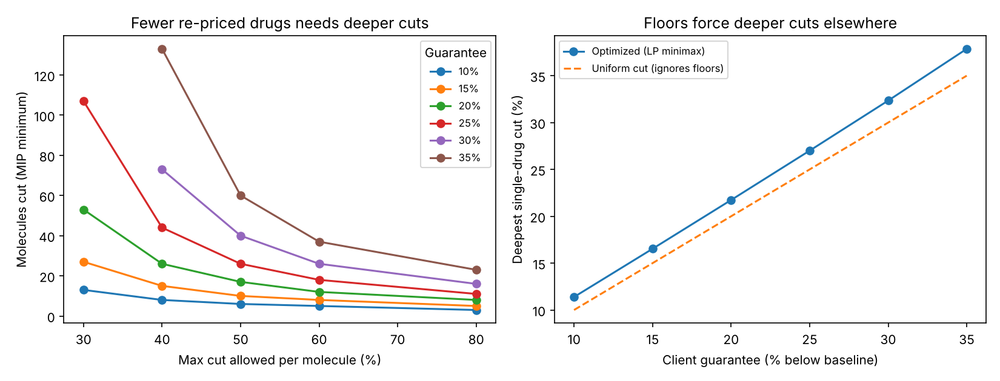

# Generic Drug Reimbursement Optimization with Gurobi

This project re-prices a generic drug list so a health plan client's spend meets a contracted discount guarantee. It never reimburses a pharmacy below acquisition cost and never moves one drug too far in a single cycle. It also forecasts which drugs' acquisition costs are about to spike, so pricing buffers go where they're needed. Everything runs as a tested API with CI/CD to Google Cloud Run and Vertex AI training.

Everything is built on real CMS data: NADAC acquisition costs (a July 2026 snapshot plus 2020 to 2022 weekly history), Medicare Part D spending, and Medicaid utilization.

**Business summary:** [docs/decision_memo.md](docs/decision_memo.md)

## 1. Reimbursement optimizer (Gurobi LP + MIP)

### Problem

A pharmacy benefit manager sets maximum allowable cost (MAC) style reimbursement rates for generics. A client contract guarantees total generic spend falls at least *D%* below baseline. The new rates must:

* meet that guarantee,
* stay at or above acquisition cost (NADAC) for every drug,
* cut no drug more than a per-cycle cap, and
* lift drugs currently paid below cost back up to the floor.

### Data

| Field | Source | Level |
|---|---|---|
| Acquisition cost per unit | CMS NADAC, effective 2026-07-15 | strength |
| Current spend per unit, annual units | CMS Medicare Part D Spending by Drug, generic-name "Overall" rows (most recent annual release as of 2026-07-16; the snapshot does not record the data year) | molecule |
| Strength volume mix | CMS State Drug Utilization Data (Medicaid units) | strength |

The CMS hosts were not reachable from the build environment. The joined values therefore come from the open [Cost Plus Arbitrage dataset](https://github.com/AgastyaDhar/costplus-arbitrage) (CC-BY-4.0), which pulls these exact CMS files and documents its provenance. The file is committed with a SHA-256 that CI verifies.

**Preparation** (`src/macopt/data.py`):

* Of 2,062 rows, 1,151 have both NADAC and Part D values.
* Part D exists only per molecule, so rows collapse into 351 molecules.
* Dropped: 51 molecules that mix units (tablets with mL) and 3 with a Part D to NADAC ratio outside 0.5x to 50x.
* Result: **297 molecules, $12.73B Part D gross generic spend**.
* Each molecule's floor is NADAC weighted by its real Medicaid strength mix.

### Models (`src/macopt/model.py`)

1. **Uniform cut (baseline).** Cut every drug by *D%*.
2. **Minimax LP.** Meet the guarantee while minimizing the deepest single-drug cut. The dual value of the guarantee constraint prices each extra guarantee point.
3. **Min-touch MIP.** Meet the guarantee while re-pricing as few molecules as possible, using binary re-price flags with linking constraints. Untouched drugs stay exactly at baseline.
4. **Feasibility and IIS.** Compute the largest reachable guarantee. For an impossible contract, Gurobi's irreducible infeasible subsystem (IIS) identifies the conflicting constraints.

Base policy: 20% guarantee, floor = NADAC, 60% maximum cut per drug, underwater drugs lifted. Contract terms are swept because they are scenarios, not data.

### Results

| Approach | Outcome |
|---|---|
| Uniform 20% cut | **56 molecules below acquisition cost**: a $211.6M pharmacy shortfall on $488.9M of spend |
| Minimax LP | Guarantee met with a **deepest cut of 21.7%**; 61 molecules at floor, 34 lifted |
| Min-touch MIP | Guarantee met re-pricing **46 molecules (34 required lifts plus 12 discretionary cuts)**. Proven optimal, 0% gap, 594 variables, 926 constraints |

* **Shadow price.** Each extra guarantee point deepens the largest cut by 1.05 points. A re-solve at 21% confirmed it (forecast 22.782%, actual 22.784%).
* **Where the savings are.** The 12 cuts are high-volume staples where Part D spend runs 2.4x to 24x above NADAC: atorvastatin, abiraterone, metoprolol, rosuvastatin, omeprazole, losartan, amlodipine, tamsulosin, duloxetine, lisinopril, ezetimibe and lurasidone. They save $2.78B, against $140.1M spent lifting underwater drugs.
* **Breadth vs. depth.** At a 20% guarantee, a 30% cut cap needs 53 cuts, while an 80% cap needs 8. All 30 guarantee and cap scenarios solve to proven optimality, about 6 seconds in total.
* **Contract limits.** With a 60% cap, the most reachable guarantee is 53.4%. A 60% guarantee is infeasible, and the IIS isolates the guarantee against the per-drug lower bounds.
* **Floor sensitivity.** A floor of NADAC +10% gives a 22.4% deepest cut and 56 re-priced (44 lifts). Without lifts, 11 cuts and a 20.6% deepest cut.
* **Robustness.** The source matches drugs by name, so some formulations were merged (carvedilol ER capsules at $6.67/unit under carvedilol at $0.064). That makes a highest-strength floor infeasible even at 0%. The 46 molecules whose strength-level NADAC spans more than 5x were dropped as a check. On the remaining 251 ($9.71B), results hold: uniform cut breaks 48 floors, deepest LP cut 20.5%, MIP re-prices 38 (30 lifts plus 8 cuts).



## 2. Acquisition-cost spike model (LightGBM)

A rate set at today's NADAC goes underwater if acquisition cost rises after the rate is set. `src/macopt/costrisk.py` predicts that risk.

* **Data.** Real CMS NADAC price history per NDC (11-digit) from [mwine81/nadac](https://github.com/mwine81/nadac) (`nadac.parquet`, commit 3b23f28). It has 760,110 effective-date intervals with no gaps or overlaps across 711,534 transitions. Rebuilt into a weekly panel of 6,461,819 prices for 48,576 NDCs (Jan 2020 to Sep 2022).
* **Label.** NADAC rises 10% or more at any point in the next 13 weeks.
* **Features.** History only: 4/13/26/52-week returns, 52-week volatility, change count, weeks since last change, price level, sibling-package, labeler and market moves.
* **Split.** Examples come every 4 weeks, 863,504 in total. Training origins end 2021-09-29 (421,737 rows). Test origins run Jan to Jul 2022 (267,648 rows, 8.8% positive). Training labels end before the first test origin. A unit test checks that labels and features never look ahead.

| Model (2022 test) | ROC-AUC | PR-AUC | Precision in top 10% |
|---|---|---|---|
| "Recent riser keeps rising" rule (13-week return) | 0.288 | 0.073 | 10.3% |
| Logistic regression | 0.887 | 0.426 | 43.4% |
| **LightGBM** | **0.892** | **0.436** | **43.8%** |

* The momentum rule is worse than random. Drugs that just rose tend not to rise again soon.
* LightGBM beats logistic regression only slightly. Most of the signal is in 52-week volatility (40% of gain).
* Calibration is close in the low deciles. The top decile is over-confident (55% predicted vs. 44% actual).

**Decision back-test.** Each NDC gets the same average safety buffer, either flat or scaled by predicted risk (capped at 50%). Every NDC is weighted equally, because no per-NDC volume is available. A price-weighted comparison was tried and dropped, since it lets cheap generics take big buffers almost for free and overstates the gain.

| Average buffer | Flat: breach rate | Risk-based: breach rate | Reduction |
|---|---|---|---|
| 2% | 22.9% | 20.7% | 9% |
| 5% | 15.8% | 12.3% | 22% |
| 10% | 8.8% | 5.5% | 38% |

## 3. Production: API, container, CI/CD, Vertex AI

* **API** (`src/macopt/api.py`, FastAPI):
  * `/optimize` runs the LP or MIP for any policy, returns 422 with the reachable limit for impossible guarantees, and logs structured JSON.
  * `/cost-risk/score` scores NDCs with the saved model.
  * `/health` reports status.
  * Measured on a local uvicorn server: `/optimize` (MIP) p50 14.9ms / p95 18.9ms over 20 calls; `/cost-risk/score` single record p50 3.4ms / p95 5.2ms over 50 calls; a 1,000-record batch in 39ms.
* **Container** (`Dockerfile`): Python 3.12 slim, non-root user, serves on `$PORT` for Cloud Run.
* **CI** (`.github/workflows/ci.yml`, every push): ruff lint, data checksum verification, 14 pytest tests, full optimizer re-run, outputs uploaded as an artifact.
* **CD** (`.github/workflows/deploy.yml`, after CI passes on `main`): keyless Workload Identity Federation auth, then build, push to Artifact Registry, deploy to Cloud Run (authenticated only), and smoke-test the live `/health` and `/optimize`. A manual run can also submit a **Vertex AI custom training job** using the same image, writing the model to Cloud Storage.
* **GCP setup** (`deploy/setup_gcp.sh`): enables the APIs and creates the Artifact Registry repo, model bucket, deploy service account and Workload Identity Federation for this GitHub repo.
* **Local workflow:** VS Code workspace settings, debug configurations for the optimizer, trainer and API, ruff, and pre-commit hooks.

**Verification status.** Tests, lint, workflow lint (actionlint), shell lint (shellcheck) and the live local API all pass in the build environment. The Docker image build, GitHub Actions runs, Cloud Run deployment and Vertex AI job have not run yet. Container registries were blocked from the build environment, and they need the owner's GCP project. See [Deploy](#deploy).

## Run locally

```bash
pip install -r requirements.txt
python -m pytest -q                          # 14 tests
PYTHONPATH=src python -m macopt.run          # optimizer scenarios -> outputs/
PYTHONPATH=src python -m macopt.train        # cost-spike model -> models/, outputs/
PYTHONPATH=src uvicorn macopt.api:app --port 8080
```

Gurobi's pip package includes a size-limited license (2,000 variables and 2,000 constraints). Every model here fits within it.

## Deploy

1. Push this repo to GitHub.
2. In Google Cloud Shell, run `PROJECT_ID=<project> GITHUB_REPO=<owner>/<repo> bash deploy/setup_gcp.sh`.
3. Add the six repository variables it prints in GitHub.
4. Push to `main`. CI runs, then deploy builds and ships to Cloud Run.
5. To train on Vertex AI, open Actions, choose *deploy*, then *Run workflow*, and check *train_on_vertex*.

## Limitations

* Part D "spend per unit" is gross program spend (pre-rebate, including dispensing). It stands in for current reimbursement and is not any plan's actual rates.
* NADAC (July 2026) is later than the Part D year, so some of the 34 "underwater" molecules may reflect cost increases since then.
* The Medicaid strength mix stands in for the Medicare mix. Rates are set per molecule because Part D is only published per molecule, while real MAC lists price each strength and form.
* The cost-spike history ends in Sep 2022, and it includes brand NDCs because the history has no brand/generic flag. The model would need current weekly NADAC to score today's list.
* Guarantee levels, cut caps, floor markups and buffer sizes are scenarios, not any real contract's terms.

## Layout

```
data/raw/            leaderboard.csv, nadac_history.parquet (+ .sha256)
src/macopt/          data.py, model.py, run.py, costrisk.py, train.py, api.py
tests/               optimizer checks, no-look-ahead check, API tests
models/              cost_risk_lgbm.txt, cost_risk_meta.json
outputs/             results.json, cost_risk_results.json, CSVs, tradeoffs.png
deploy/setup_gcp.sh  one-time GCP + Workload Identity setup
docs/decision_memo.md
```

Data attribution: Dhar, A. *Cost Plus Arbitrage Dataset* (CC-BY-4.0), and the NADAC history compiled in github.com/mwine81/nadac, both derived from U.S. public-domain CMS data (NADAC, Medicare Part D Spending by Drug, State Drug Utilization Data).
